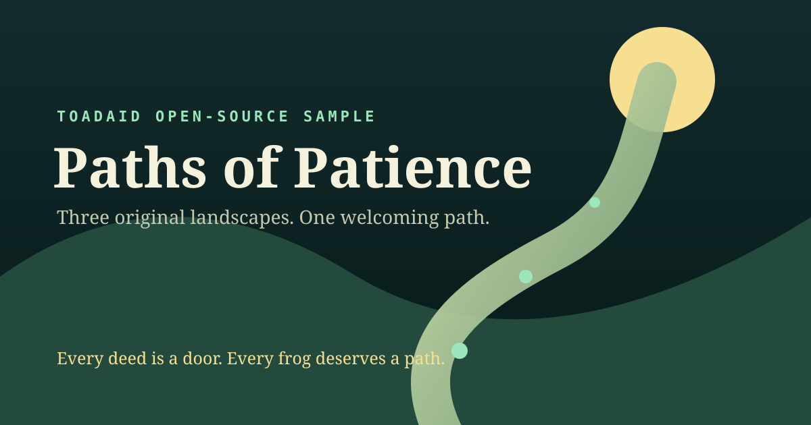

# Paths of Patience — Open Source Sample

**Built by ToadAid, for the Toadgang community.**

Made with love for the lore, the lands, and every frog who finds the pond. 🌱

*Paths of Patience* is a small browser exploration game about moving thoughtfully, tending living things, and knowing when to yield. This public-edition candidate contains three original abstract landscapes, a reusable gameplay engine, and no wallet, login, analytics, ads, token promotion, paid service, or private infrastructure.



> This is a ToadAid-created community project and code sample. It is not an official Tobyworld or Toadgod product, and it does not include the canonical Lore Land archive or the full production game's artwork.

## Play

The full community game remains available at [tobyworld-game.vercel.app](https://tobyworld-game.vercel.app). It has different content and separate asset rights.

This clean edition is staged at [ToadAid/tobyworld-game-public](https://github.com/ToadAid/tobyworld-game-public), which remains **private while publication approval is pending**. Authorized collaborators can clone and run it with:

```bash
git clone https://github.com/ToadAid/tobyworld-game-public.git
cd tobyworld-game-public
python3 -m http.server 8080
```

Then open <http://localhost:8080>. No package installation or build step is required for play.

The clone command currently requires GitHub access to the private staging repository. It must be tested again as an unauthenticated visitor after — and only after — separate publication approval changes repository visibility.

## What is included

- Three original sample worlds: Moonlit Garden, Reedwater Crossing, and Sunrise Terrace.
- Grid movement, collectible garden lights, Patience tending, a Yield gate, a wayfinding beacon, and Core completion.
- Local progression and best-move saves under a sample-only storage key.
- Keyboard, touch, and standard gamepad controls.
- Responsive portrait and landscape layouts, fullscreen, reduced-motion support, and an installable offline PWA shell.
- Original synthesized browser audio with no bundled recordings.
- Tests and a graph audit for sample-world reachability.

## Controls

| Action | Keyboard | Touch | Gamepad |
|---|---|---|---|
| Move | Arrow keys or WASD | Direction pad | Left stick or D-pad |
| Patience | Hold Space beside a sprout | Hold Patience | Hold A |
| Yield | Q beside the gate | Use Yield | B |
| Pause | Escape or the pause button | Pause button | Start |

You can mute audio or request fullscreen from the game header. All primary controls have visible keyboard focus and labeled touch targets.

## Full game versus this edition

The private source project and existing Vercel deployment contain a twelve-world campaign, a 2,869-deed explorer, canonical deed references, imagined Lore Land artwork, characters, and generated sandboxes. Those materials are **not** copied into this candidate because redistribution permission has not been established for every category.

This edition preserves the general gameplay technology and welcoming intent with new sample data and original code-native Canvas/SVG scenery. It does not claim to reproduce canonical lore, all twelve worlds, or all 2,869 deeds.

## Development

Node.js is only needed to run the dependency-free checks:

```bash
npm run check
npm test
npm run audit:samples
git diff --check
```

The runtime itself is plain HTML, CSS, JavaScript modules, Canvas, SVG, Web Audio, and a service worker.

## Contributing

New builders are welcome. You can report bugs, improve accessibility, propose focused mechanics, translate interface text, strengthen tests, or contribute original landscapes with complete provenance. Read [CONTRIBUTING.md](CONTRIBUTING.md), [CODE_OF_CONDUCT.md](CODE_OF_CONDUCT.md), and [ASSET_LICENSE.md](ASSET_LICENSE.md) first.

Security reports must use a private channel described in [SECURITY.md](SECURITY.md), never a public issue.

## Community

- [Join Toadgang](https://t.me/toadgang) — meet the community and discover the lore.
- [Explore Tobyworld](https://tobyworld.app) — discover the wider Tobyworld ecosystem.
- [Follow Toadgod](https://x.com/toadgod1017) — read Toadgod's posts and explore the source of the lore.

These links open external community spaces. They are not runtime dependencies.

## License and project status

Eligible ToadAid-owned code is proposed under the [MIT License](LICENSE), subject to human approval. That grant does not cover names, marks, lore, artwork, or third-party material outside the explicit boundaries in [ASSET_LICENSE.md](ASSET_LICENSE.md).

This directory is a release candidate, not a published public repository. Current limitations and evidence are recorded in [PUBLIC_RELEASE_AUDIT.md](PUBLIC_RELEASE_AUDIT.md).

Every deed is a door. Every frog deserves a path.
