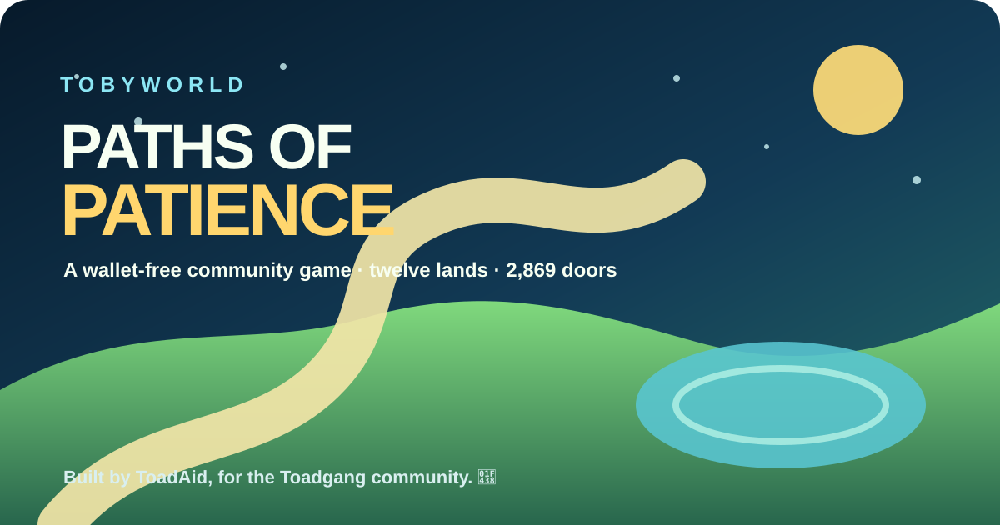

# 🐸 Tobyworld: Paths of Patience

**Built by ToadAid, for the Toadgang community.**

Made with love for the lore, the lands, and every frog who finds the pond. 🌱

*Paths of Patience* is a free, wallet-free maze adventure through twelve Lore Land worlds. Guide Toby, tend what grows, learn when to yield, and open a gentle path into the Tobyworld community.

[Play the live game](https://tobyworld-game.vercel.app/) · [Join Toadgang](https://t.me/toadgang) · [Explore Tobyworld](https://tobyworld.app/) · [Follow Toadgod](https://x.com/toadgod1017)



> This is a ToadAid-created community game adaptation. It is not a claim of official endorsement by Tobyworld or Toadgod.

This repository contains the **real full-game browser runtime**, including the
12-world campaign, Lore Land explorer, and production game assets. It is
**not** the earlier three-world sample.

## Play locally

This repository is publicly available. Clone it and serve the browser game with Python 3:

```bash
git clone https://github.com/ToadAid/tobyworld-game-public.git
cd tobyworld-game-public
python3 -m http.server 7777 --bind 127.0.0.1
```

Open <http://127.0.0.1:7777/> in a browser on the same computer.
Compare the experience with <https://tobyworld-game.vercel.app/>.
Stop the local test server with `Ctrl+C`.

Port **7777** is a suggested local test port, not a production setting.
If it is occupied, select another unused port; do not stop unrelated services.

## Explore the real game

- **12-world campaign** with local saves, objectives, scores and unlocks.
- **2,869 canonical Lore Land Deeds** indexed for lookup, plus deterministic sandbox worlds built from each deed's five signs.
- Keyboard, touch, standard-controller, audio and accessibility controls.
- No wallet, login, analytics, advertising or gameplay backend.

### Controls

Arrow keys / WASD move Toby; hold **Space** for Patience; **Q** uses Yield; **P** or **Escape** pauses. On phones, use the on-screen controls; a compatible gamepad is also supported.

### Developers

The browser runtime has no npm dependencies. Node.js and Python 3 are required only for local development checks and optional authorized asset builders.

```bash
npm run check
npm test
npm run audit:sandboxes
```

Test routes: `?test=1` for the twelve stages, `?test=1&deed=715` for a stage, `?lookup=94` for deed lookup, and `?sandbox=1&deed=94` for sandbox play.

Read [CONTRIBUTING.md](CONTRIBUTING.md), [CODE_OF_CONDUCT.md](CODE_OF_CONDUCT.md), [SECURITY.md](SECURITY.md), [CAMPAIGN_STORY.md](CAMPAIGN_STORY.md), [COMMUNITY_ONBOARDING_P1.md](COMMUNITY_ONBOARDING_P1.md), and [PHYSICAL_DEVICE_QA.md](PHYSICAL_DEVICE_QA.md).

## Licenses and rights

**The repository is public**, and ToadAid's eligible original game source code and code-oriented documentation are provided under the [MIT License](LICENSE). You can inspect, run, study, fork, and contribute to the code under its applicable terms.

**Artwork and lore are different.** Tobyworld characters and names, canonical Lore Land Deed images and descriptions, Keeper artwork, imagined landscapes, and related third-party content are **not automatically licensed under MIT** just because their files are visible in a public repository. Copyright and trademark rights remain with their respective owners; obtain permission or verify separate license terms before reusing those materials.

See [ASSET_LICENSE.md](ASSET_LICENSE.md) for the asset inventory and [CONTRIBUTING.md](CONTRIBUTING.md) for contribution guidance. This public game is a ToadAid community adaptation and does not claim official Tobyworld or Toadgod endorsement.

## Repository status

**PUBLIC** — full 12-world browser game, indexed 2,869-deed explorer and generated sandboxes, tests, and documentation. Run it locally with port **7777** or try the [live game](https://tobyworld-game.vercel.app/).

Some earlier private-staging notices may remain visible in historical Git commits or old review branches; they are historical, not the current `main` documentation. Public visibility does not itself establish permission to distribute third-party assets.
